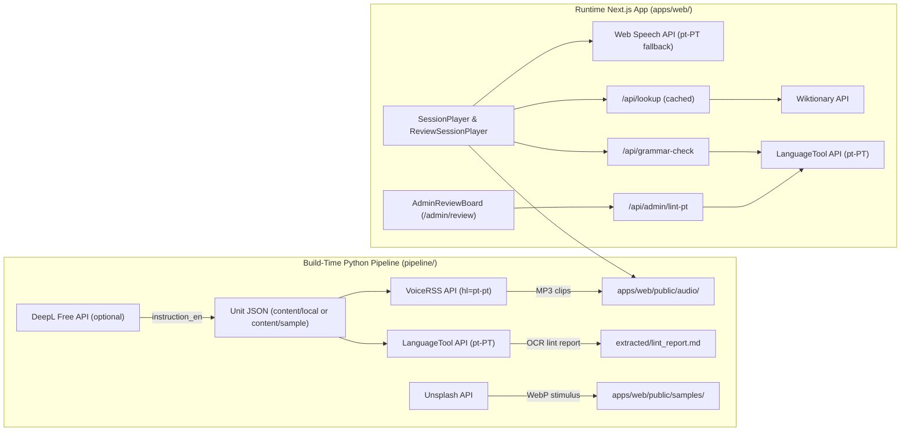

# PRD: European Portuguese (`pt-PT`) Public API Integrations for Passaporte

- **Status:** Draft
- **Owner:** Justice Otuya
- **Target Repo:** `justiceotuya/passaporte`
- **Target Variant:** European Portuguese (`pt-PT`) for English-speaking A1 learners
- **Related Doc:** [`IMPLEMENTATION_PLAN-pt-pt-apis.md`](./IMPLEMENTATION_PLAN-pt-pt-apis.md)

---

## 1. Problem Statement

Passaporte turns European Portuguese (`pt-PT`) textbooks into Duolingo-style SM-2 practice sessions, but five gaps currently limit both learner comprehension and content authoring velocity:

1. **No real listening practice:** `listen_choice` items display a collapsible text transcript (`ListenTranscript.tsx`) with no audio, so learners cannot train for European Portuguese vowel reduction and cadence.
2. **Manual OCR typo hunting:** Scanned textbook extraction (`pipeline/extract.py`) can drop Portuguese diacritics (`nao` vs `não`, `esta` vs `está`) or drift into `pt-BR` phrasing, requiring manual catches during `/admin/review`.
3. **Unplayable `open` items & opaque typed mistakes:** `schema/item.schema.json` supports `"type": "open"`, but `isPlayableItem()` excludes them. On typed `fill_blank` / `transform` misses, `grader.ts` gives a generic retry message without explaining *why* the answer was wrong.
4. **Context-breaking vocabulary lookups:** Learners who forget a word inside a Portuguese prompt or transcript have to leave the session to check a dictionary.
5. **Authoring overhead & LLM spend on routine steps:** Growing `content/sample/` from 3 to 6 units needs clean stimulus imagery, and translating static instructions in `pipeline/instructions_en.py` currently requires paid Anthropic API calls.

---

## 2. Goals & Non-Goals

### Goals
- Strictly preserve **European Portuguese (`pt-PT`)** pronunciation, spelling, and grammar—never silently default to `pt-BR`.
- Preserve Passaporte's **offline-first, deterministic core**: pre-generate static assets in `pipeline/` so core drills and the planned PWA never depend on third-party uptime.
- Keep **runtime drills $0 in LLM cost** by using free/public APIs (VoiceRSS, LanguageTool, Wiktionary, Web Speech API) with caching and graceful degradation.
- Maintain strict **JSON Schema contract parity** across `schema/item.schema.json`, `apps/web/src/types/item.ts`, and `pipeline/models.py`.

### Non-Goals
- **Replacing `pipeline/hints.py`:** Pedagogical A1 hints with answer-leak validation remain LLM-generated.
- **Putting external APIs on the grading critical path of closed items:** `grader.ts` remains 100% synchronous, local, and deterministic.
- **Building a generic news/immersion feed in v1:** Focus stays on the textbook & sample-unit study loop.
- **Committing copyrighted textbook assets:** Generated audio for `content/local/` stays gitignored (just like `apps/web/public/crops/`).

---

## 3. Architecture Overview

---

## 4. Feature Requirements

### F1: European Portuguese Listening Audio (`listen_choice` + Read-Aloud)

**User Story**
As an A1 learner, I want to hear `listen_choice` passages spoken in European Portuguese (`pt-PT`) before seeing the transcript so I actually practice listening comprehension.

**Functional Requirements**
1. **Schema extension:** Add optional `"audio": string | null` to `schema/item.schema.json`, `apps/web/src/types/item.ts`, and `pipeline/models.py`, storing a relative path under `apps/web/public/` (e.g., `audio/sample/demo-u01-p003-F-1.mp3` for sample content, `audio/local/<id>.mp3` gitignored for personal books).
2. **Build-time generator (`pipeline/audio.py`):**
   - Scans units for items with a non-empty `transcript` (and optionally `--include-answers` for canonical spoken answers) where `audio` is missing or `--force` is set.
   - Calls VoiceRSS (`hl=pt-pt`, `c=MP3`, configurable codec/speed via env/flags) and writes MP3 files deterministically by item ID.
   - Updates unit JSON with the relative `audio` path and validates against `PassaporteUnit`.
   - Supports `--dry-run`, `--units`, and `--limit` (matching `hints.py` and `instructions_en.py`).
3. **Player UX (`ListenTranscript.tsx` → audio-first player + `SessionPlayer.tsx`):**
   - Renders **Play / Pause**, **Replay**, and **Slow (0.8×)** controls above the options.
   - Uses `<audio>` when `item.audio` exists; falls back cleanly to browser `window.speechSynthesis` picking a `pt-PT` voice (with a visible warning badge if the device only has a `pt-BR` or missing voice).
   - **Transcript lock:** During `phase === "playing"`, transcript is hidden by default (with an explicit opt-in "Need help? Reveal transcript" toggle or locked until `phase === "feedback"` based on a setting, defaulting to hidden until feedback).
   - **Bonus read-aloud:** Small speaker button in `FeedbackBanner` to hear the correct Portuguese answer aloud after answering.

**Acceptance Criteria**
- `listen_choice` items play European Portuguese audio via static MP3 when `audio` is present, and via Web Speech `pt-PT` when `audio` is absent.
- Transcript is hidden before answering and automatically available during `phase === "feedback"`.
- Sample units (`content/sample/u01–u03`) pass `pnpm content:validate` and `pnpm content:ship-gate`.
- Audio playback works offline once MP3 assets are cached; missing audio never blocks answering.

---

### F2: `pt-PT` OCR & Spelling Lint Pass (Pipeline + Admin Review Board)

**User Story**
As a content reviewer importing scanned PDFs, I want automated `pt-PT` spelling and accent checks to surface OCR errors before I approve items for the ship gate.

**Functional Requirements**
1. **Pipeline linter (`pipeline/lint_pt.py`):**
   - Reads unit JSON files (`prompt`, `instruction`, `transcript`, string `answer`) and checks them against LanguageTool (`language=pt-PT`, configurable `LANGUAGETOOL_API_URL` so a self-hosted instance works too).
   - Respects rate limits (configurable delay/batching, skips blanks like `___`).
   - Emits a Markdown/JSON report (`extracted/lint_report.md`) listing item ID, field, flagged text, rule category, and top suggestions. Non-destructive (does not auto-mutate unit JSON).
2. **Admin Review integration (`/api/admin/lint-pt` + `AdminReviewBoard.tsx`):**
   - Admin-gated `POST /api/admin/lint-pt` endpoint (using existing `requireAdmin` / `assertAdminAccess`) that checks a single item's Portuguese fields on demand.
   - Adds a "Check PT-PT" button (`L` keyboard shortcut) in `AdminReviewBoard.tsx` displaying inline warnings (highlighted span + suggested replacement) next to the prompt editor.

**Acceptance Criteria**
- `pipeline/lint_pt.py --dry-run` reports candidate fields without making network calls.
- `/api/admin/lint-pt` returns `401/403` for non-admin users and structured diagnostics for authorized admins.
- Network failure or LanguageTool timeout degrades gracefully to a toast warning without blocking approve/reject actions.

---

### F3: Unlock `open` Items & Smart Mistake Diagnostics (`pt-PT`)

**User Story**
As a learner answering typed exercises (`fill_blank`, `transform`, and textbook `open` questions), I want specific European Portuguese grammar/accent feedback on mistakes rather than a generic "Not quite" banner.

**Functional Requirements**
1. **Grammar-check proxy (`POST /api/grammar-check`):**
   - Authenticated (or dev-local) Next.js route calling LanguageTool (`language=pt-PT`) with strict payload cap (max 500 chars), timeout (3s), and basic in-memory LRU cache.
   - Returns normalized diagnostics: `{ issues: [{ message, shortMessage, offset, length, replacements, ruleCategory }] }`.
2. **Typed miss diagnostics (`SessionPlayer.tsx` + `FeedbackBanner.tsx`):**
   - Keep `grader.ts` 100% synchronous and authoritative for correctness/XP/SM-2.
   - When attempt 1 is incorrect on `fill_blank` or `transform` (and the learner is online), asynchronously fetch `/api/grammar-check` for the learner's submitted text (or filled sentence) and append a non-blocking tip inside `FeedbackBanner.tsx` (e.g., *"Check accent: `nao` → `não`"*).
3. **Playable `open` items (opt-in practice mode):**
   - Add a `LearnerSettings` toggle (`includeOpenItems: boolean`, default `false` so existing unit tests and strict closed-item sessions remain unchanged; or a dedicated practice filter).
   - Build `OpenResponseInput.tsx`: multiline text area + "Check Portuguese" button that runs `/api/grammar-check`, highlights any `pt-PT` issues, then reveals the book's model `answer` (if present) for self-assessment ("I got it" / "Review again") wired into SM-2.

**Acceptance Criteria**
- Closed-item grading speed, XP calculation, and offline behavior are completely unchanged when offline or when `/api/grammar-check` times out.
- Existing `session-builder.test.ts` and `grader.test.ts` remain green without breaking closed-item defaults.
- `open` items can be practiced end-to-end when enabled, with mocked LanguageTool responses in Vitest/MSW and Playwright.

---

### F4: Anti-Spoiler Tap-to-Define Word Popover

**User Story**
As an A1 learner reading a Portuguese prompt or transcript, I want to tap an unfamiliar word to see its English meaning, gender, and Lisbon IPA without leaving Passaporte—and without accidentally spoiling the exercise answer.

**Functional Requirements**
1. **Lookup proxy (`GET /api/lookup?word=<token>`):**
   - Queries Wiktionary REST/MediaWiki API (`en.wiktionary.org` Portuguese section first for English glosses, falling back to `pt.wiktionary.org`).
   - Parses and returns a clean, compact JSON payload: `{ word, lemma, pos, gender, ipaPt, definitions: string[], sourceUrl }`.
   - Caches results server-side (in-memory LRU + HTTP `Cache-Control: public, max-age=86400`) and validates single-word sanitized input.
2. **Interactive word tokens (`WordLookupText.tsx` + `WordLookupPopover.tsx`):**
   - Renders prompt/transcript text with clickable Portuguese word tokens (accessible buttons with keyboard focus and `Escape` to close).
   - Popover shows glosses, gender (`m`/`f`), Lisbon IPA (when present), and a **Listen (`pt-PT`)** button via Web Speech API.
3. **Anti-spoiler guard (`apps/web/src/lib/spoiler-guard.ts`):**
   - Ports the answer-folding logic from `pipeline/hints.py` (`answer_strings` + diacritic folding) to TypeScript.
   - While `phase === "playing"`, tokens matching the item's `answer` or `accepted` values are non-clickable (or disabled with tooltip *"Unlocked after answering"*).
   - Once `phase === "feedback"`, all tokens unlock.

**Acceptance Criteria**
- Tapping a non-spoiler word in a prompt opens a popover with English definition(s) within ~300ms (cached) or displays a clean "No entry found" state.
- Target answer tokens cannot be looked up during `phase === "playing"` (verified by unit + E2E tests).
- Works smoothly with keyboard navigation and screen readers (`aria-expanded`, `role="dialog"`).

---

### F5: Sample Units Stimulus Helper & Optional DeepL Pipeline Backend

**User Story**
As the repo author expanding `content/sample/` from 3 to 6 units and running the local PDF pipeline, I want free, license-safe stimulus images and a zero-cost `pt-PT` / `en` translation option.

**Functional Requirements**
1. **Sample image helper (`pipeline/fetch_sample_images.py`):**
   - CLI taking a search query and output slug (`--query "portuguese breakfast" --slug demo-breakfast`), fetching a photo via **Unsplash API** (`UNSPLASH_ACCESS_KEY`), resizing/converting to `.webp` with Pillow (already a pipeline dependency) into `apps/web/public/samples/<slug>.webp`, and recording photographer attribution in `content/sample/ATTRIBUTIONS.md`.
2. **Optional DeepL Free backend (`pipeline/instructions_en.py`):**
   - Add `--provider {anthropic,deepl}` flag (default `anthropic` for backwards compatibility).
   - When `--provider deepl` is selected, call `https://api-free.deepl.com/v2/translate` using `DEEPL_API_KEY` (`source_lang=PT`, `target_lang=EN-GB` or `EN-US`), with batching and failure logging matching the existing flow.

**Acceptance Criteria**
- Downloaded sample images are optimized `.webp` files (`<= 800px` wide) with attribution logged automatically.
- `instructions_en.py --provider deepl` passes pytest with mocked HTTP calls and preserves identical unit JSON output format.

---

## 5. External APIs, Quotas & Configuration

| API | Used In | Variant Control | Auth Env Var | Free Quota / Notes |
| :--- | :--- | :--- | :--- | :--- |
| **VoiceRSS** | `pipeline/audio.py` | `hl=pt-pt` | `VOICERSS_API_KEY` | 350 req/day free tier; build-time only so quota goes far |
| **Web Speech API** | `apps/web/` | `lang = "pt-PT"` | None | Browser-native zero-cost fallback |
| **LanguageTool** | `pipeline/lint_pt.py`, `/api/grammar-check`, `/api/admin/lint-pt` | `language=pt-PT` | Optional `LANGUAGETOOL_API_URL` | Free keyless public endpoint (fair-use ~20 req/min); self-hostable |
| **Wiktionary API** | `/api/lookup` | Portuguese section + `(Portugal)` IPA | None (custom `User-Agent` header required) | Free, generous; cache aggressively (`24h+`) |
| **Unsplash API** | `pipeline/fetch_sample_images.py` | N/A | `UNSPLASH_ACCESS_KEY` | 50 req/hr demo tier; build-time only, attribution required |
| **DeepL API Free** | `pipeline/instructions_en.py` (optional) | `PT` / `PT-PT` | `DEEPL_API_KEY` | 500,000 chars/month free |

---

## 6. Non-Functional Requirements

- **Offline / PWA safety:** Zero hard runtime dependencies on third-party APIs. Core drills, SM-2, and pre-generated audio work offline; live endpoints fail silently or show a subtle "Offline — check unavailable" note.
- **Privacy:** Never send user emails, IDs, or Convex tokens to external language APIs—only anonymous Portuguese text snippets or single words.
- **Security:** Keep `VOICERSS_API_KEY`, `DEEPL_API_KEY`, and `UNSPLASH_ACCESS_KEY` strictly server/pipeline-side (never `NEXT_PUBLIC_*`). Gate `/api/admin/lint-pt` behind `assertAdminAccess`.
- **Testing:** All external HTTP calls must be mocked in Vitest (via existing `apps/web/src/mocks/handlers.ts` MSW setup), Playwright, and `pytest` (`pipeline/tests/`)—CI must never depend on live external APIs.

---

## 7. Success Metrics & Rollout Order

| Phase | Feature | Primary Metric / Gate |
| :--- | :--- | :--- |
| **Phase 0** | Schema & Config Contract | `pnpm test:schema` + `pnpm content:validate` green |
| **Phase 1** | F1 — Listening Audio (`pt-PT`) | 100% of `listen_choice` items in `content/sample/` play audio with transcript hidden pre-answer |
| **Phase 2** | F2 — `pt-PT` OCR Lint | `pipeline:lint-pt` flags seeded accent/cedilla typos in pytest; admin button works in `/admin/review` |
| **Phase 3** | F4 — Tap-to-Define Popover | Zero answer-token leaks during `playing`; `<300ms` cached Wiktionary lookup |
| **Phase 4** | F3 — `open` Items + Mistake Tips | Attempt-1 typed misses surface `pt-PT` diagnostics when online; `open` items playable when toggled on |
| **Phase 5** | F5 — Sample Images & DeepL Option | New sample units `u04–u06` have attributed `.webp` assets; `instructions_en.py --provider deepl` green |
